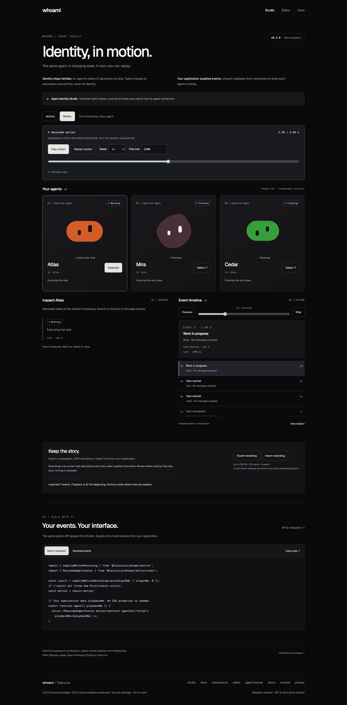

# whoami

A familiar face for every agent. Stable SVG identities, caller-driven task activity, React components, and an interactive Agent Identity Studio.

This checkout is the **v0.3.0 development milestone** (`0.3.0-dev.0`), with optional recorded-motion sampling and Motion mode in the existing dark Studio. Existing APIs and identities are preserved. No v0.3.0 release is published.



[Mobile Motion Studio](assets/studio-motion-mobile.png)

**v0.2.0** is a source distribution of the agent identity and activity toolkit. The [GitHub repository](https://github.com/talarurus/whoami) is public. `whoami` remains a provisional product name; the package remains `@talarurus/whoami`. It is not published to npm, and no production website is deployed. The **v0.1.0** tag remains the immutable source-release baseline.

## Run the website

Use Node **24.21.0 or later in Node 24** and npm **11**. Cloning this public repository does not require a GitHub account.

```sh
git clone https://github.com/talarurus/whoami.git
cd whoami
npm ci
npm start
```

Open [Agent Identity Studio](http://localhost:4318/studio), [the website](http://localhost:4318), [editor](http://localhost:4318/editor), [components](http://localhost:4318/components), or [documentation](http://localhost:4318/docs). Stop with Ctrl-C. `PORT=4320 npm start` selects another port; restart to rebuild after edits.

## Use the source package

```sh
# In the whoami checkout
npm run build
npm pack
# In a separate application
npm install /absolute/path/to/talarurus-whoami-0.3.0-dev.0.tgz
```

The package name below resolves through that local tarball. It is **not** an npm registry installation instruction.

```js
import { svgFor, identity } from '@talarurus/whoami';

const config = { name: 'agent-001', expression: 'happy' };
const svg = svgFor(config, 128);
console.log(identity(config).canonicalSeed);
```

The SVG entry has no runtime dependencies and includes TypeScript declarations. `node examples/svg.mjs` runs this path after building.

```tsx
import { Face } from '@talarurus/whoami/react';
import '@talarurus/whoami/motion.css';
import '@talarurus/whoami/gaze.css';
import '@talarurus/whoami/react.css';

export default function AgentAvatar() {
  return <Face name="agent-001" size={128} motion="always" pointerGaze
    decorative={false} label="Agent 001" />;
}
```

React **19.2** is a peer dependency for React consumers. Run `npm run example:react` after building, then open http://localhost:4319. See [API and integration](docs/api.md) and the [working TypeScript example](examples/react/main.tsx).

## Agent activity

```tsx
import { createActivityEngine } from '@talarurus/whoami/activity';
import { AgentAvatar } from '@talarurus/whoami/activity/react';

const engine = createActivityEngine({ agents: [{ id: 'atlas' }] });
const result = engine.dispatch({
  version: 1, agentId: 'atlas', taskId: 'task-001',
  sequence: 1, timestamp: 0, type: 'task.started',
});
if (!result.ok) console.error(result.code, result.error);

export function Agent() {
  return <AgentAvatar engine={engine} agentId="atlas" />;
}
```

Import the three CSS entries shown in the Face example for animated avatars. Optional `AgentScene` is exported from `@talarurus/whoami/scenes`; import `scenes.css` and `motion.css`. The engine has no React, renderer, clock or transport dependency. Caller-supplied events produce idle, waiting, thinking, working, needs-input, completed and error states. Sequences, task IDs and transition validation protect current state; accepted history is bounded. `replayActivity(options, recording)` deterministically reconstructs a complete caller recording.

The Studio uses these public exports for independent agents, task controls, input resolution, errors/reset, a navigable timeline, replay/pause/step/seek, validated local JSON import/export and copyable examples. Built-in events and controls are clearly simulated; imported recordings are labeled as caller-supplied. Its recording is in memory, capped at 120 accepted events; new sessions preserve agent identity. See [the schema and transition rules](docs/api.md), [typed examples](examples/activity/main.tsx), and [development verification](docs/development-v0.2.0.md).

Recording files use `@talarurus/whoami/recording`:

```ts
import { serializeRecording, parseRecording } from '@talarurus/whoami/recording';
const file = serializeRecording({ agents, events: completeAcceptedEvents });
if (file.ok) {
  const imported = parseRecording(file.json);
  if (imported.ok) console.log(imported.engine.getAgents());
}
```

The versioned envelope pins exact IDs, display names, event version and renderer revision. Import validates every event through a fresh engine; a failure leaves the caller’s session unchanged. SDK limits are 1 MiB / 1,000 events / 32 agents; Studio uses 256 KiB / 120 events / 8 agents. Recordings may contain caller-supplied task descriptions: review before sharing. Files stay local, with no upload or automatic persistence. See [the complete format](docs/api.md#json-activity-recordings--version-1), [typed example](examples/activity/recording.ts), and [final refinement and separate-agent review](docs/refinement-v0.2.0.md).

## Included and experimental surfaces

The typed activity engine, React subscriptions, event replay and versioned recording format are supported v0.2.0 APIs. Optional laptop scenes and the manual `/agent-scenes` playground remain experimental presentation surfaces; their artwork and playback are adapted from existing Blobatarling code. The password helper, chat, wall and other compositions are demonstrations, not authentication, messaging or agent-monitoring services.

- Ten silhouettes, fourteen expressions and 58 geometry/motion controls.
- Stable identities, eye tracking, click reactions, reduced-motion support and responsive layouts.
- Editor pins, shape/tone sets, palette overrides, revisioned share links and static SVG/PNG exports.
- Presence, agent list, user table, password helper and group chat examples; a browser-local wall.
- Six optional **experimental manual companion scenes** at `/agent-scenes`.

The standard artwork uses pinned Blobatar generation 2. This release preserves existing renderer bytes and identity behavior. The renderer, expressions, motion, gaze and laptop artwork are reused upstream work. The activity engine, replay, React activity binding and Studio are new first-party functionality. No automatic Codex/Claude monitoring, network transport, approval backend or scene export is included. Existing compositions remain checked-in examples; `Face` remains backward compatible.

The roster is fixed per engine, with one current task per agent. Callers supply increasing per-agent sequences, nondecreasing timestamps and unique task IDs across resets. Stale/out-of-order events are rejected rather than buffered. A bounded history tail may be incomplete for replay; retain the full accepted recording. SDK recording validation enforces unique task IDs across the whole recording. Reaching the maximum safe-integer sequence requires a new session. There are no durable sessions, external approval actions, automatic integrations or authentication guarantees.

PNG export is browser-only and static. Live gaze and animation are not exported. The website server and SVG endpoint bind to loopback; there is no hosted service or hot reload. Other frameworks and native SDKs are outside this release. Desktop Chrome and emulated mobile viewport verification do not establish physical-device or all-browser compatibility.

## Checks and credits

```sh
npm run build
npm run typecheck
npm test
npm run check:release
npm run test:consumer
# With npm start running and Google Chrome installed:
npm run test:browser
```

[Release preparation](docs/releases/preparation-v0.2.0.md) records the focused current checks and publication gate. [v0.2.0 review](docs/refinement-v0.2.0.md) and [v0.1.0 validation](docs/validation.md) retain historical results and boundaries. [Provenance](docs/provenance.md) identifies adapted and independently authored work.

MIT: original renderer and adapted website code by **Alain / Alain00/blobatar**; compatible optional scene code from **SparshKaushik/blobatarling**, maintained by Sparsh Kaushik with additions authored by Khai. Original copyright notices are retained. Geist fonts are SIL OFL 1.1. See [LICENSE](LICENSE), [THIRD-PARTY-NOTICES](THIRD-PARTY-NOTICES.txt), and vendor license/source records. No upstream endorsement or legal clean-room claim is made.
