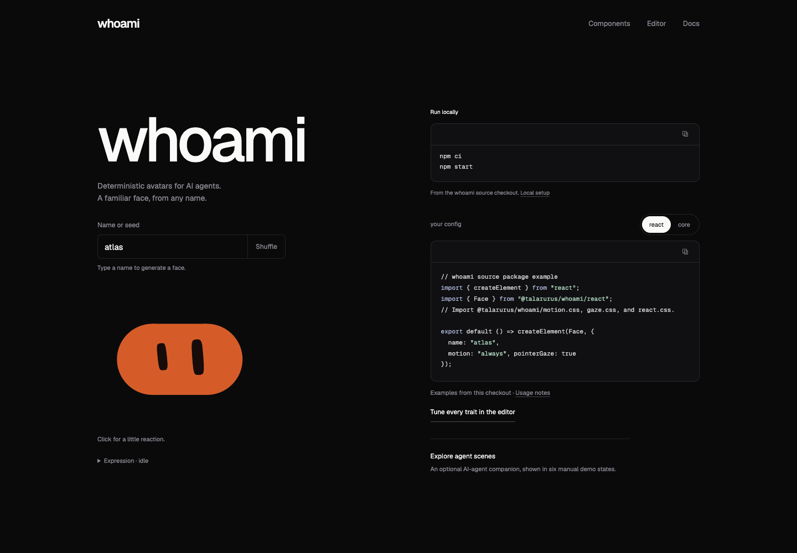

# whoami

A familiar face for every agent. A stable seed produces an expressive SVG avatar, with a local editor and a React component.



Version **0.1.0** is a GitHub **source release**, initially private. Nothing is published to npm and no production website is deployed.

## Run the website

Use Node **24.21.0 or later in Node 24** and npm **11**. Repository access requires an authorized GitHub account.

```sh
git clone https://github.com/talarurus/whoami.git
cd whoami
npm ci
npm start
```

Open [the website](http://localhost:4318), [editor](http://localhost:4318/editor), [components](http://localhost:4318/components), or [documentation](http://localhost:4318/docs). Stop with Ctrl-C. `PORT=4320 npm start` selects another port; restart to rebuild after edits.

## Use the source package

```sh
# In the whoami checkout
npm run build
npm pack
# In a separate application
npm install /absolute/path/to/talarurus-whoami-0.1.0.tgz
```

The package name below resolves through that local tarball. It is **not** an npm registry installation instruction.

```js
import { svgFor, identity } from '@talarurus/whoami';

const config = { name: 'agent-001', expression: 'happy' };
const svg = svgFor(config, 128);
console.log(identity(config).canonicalSeed);
```

The SVG entry has no runtime dependencies and includes TypeScript declarations. `node examples/svg.mjs` runs this path after building.

```tsx
import { Face } from '@talarurus/whoami/react';
import '@talarurus/whoami/motion.css';
import '@talarurus/whoami/gaze.css';
import '@talarurus/whoami/react.css';

export default function AgentAvatar() {
  return <Face name="agent-001" size={128} motion="always" pointerGaze
    decorative={false} label="Agent 001" />;
}
```

React **19.2** is a peer dependency for React consumers. Run `npm run example:react` after building, then open http://localhost:4319. See [API and integration](docs/api.md) and the [working TypeScript example](examples/react/main.tsx).

## Included

- Ten silhouettes, fourteen expressions and 58 geometry/motion controls.
- Stable identities, eye tracking, click reactions, reduced-motion support and responsive layouts.
- Editor pins, shape/tone sets, palette overrides, revisioned share links and static SVG/PNG exports.
- Presence, agent list, user table, password helper and group chat examples; a browser-local wall.
- Six optional **experimental manual companion scenes** at `/agent-scenes`.

The standard artwork uses pinned Blobatar generation 2. This release preserves existing renderer bytes and identity behavior. Companion scenes have no real agent monitoring, approval queue, session tracking, Claude/Codex integration, export or packaged scene API. Compositions are reusable checked-in examples; the packaged React API is `Face`.

PNG export is browser-only and static. Live gaze and animation are not exported. The website server and SVG endpoint bind to loopback; there is no hosted service or hot reload. Other frameworks and native SDKs are outside this release. Desktop Chrome and emulated mobile viewport verification do not establish physical-device or all-browser compatibility.

## Checks and credits

```sh
npm run build
npm run typecheck
npm test
npm run check:release
# With npm start running and Google Chrome installed:
npm run test:browser
```

[Validation](docs/validation.md) records release results and boundaries. [Provenance](docs/provenance.md) identifies adapted and independently authored work.

MIT: original renderer and adapted website code by **Alain / Alain00/blobatar**; compatible optional scene code from **SparshKaushik/blobatarling**, maintained by Sparsh Kaushik with additions authored by Khai. Original copyright notices are retained. Geist fonts are SIL OFL 1.1. See [LICENSE](LICENSE), [THIRD-PARTY-NOTICES](THIRD-PARTY-NOTICES.txt), and vendor license/source records. No upstream endorsement or legal clean-room claim is made.
