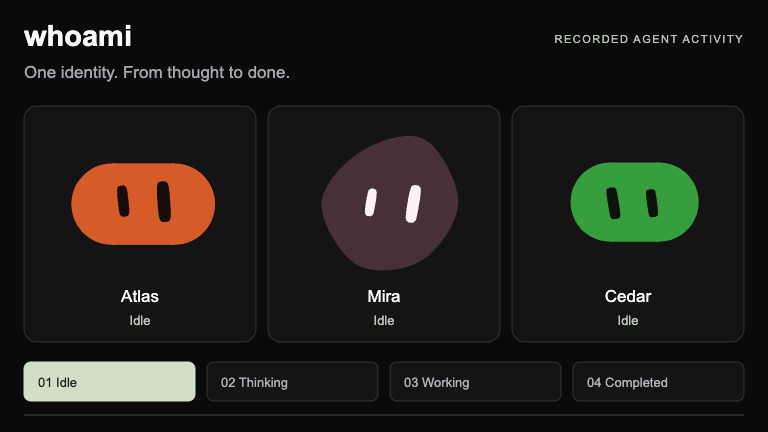
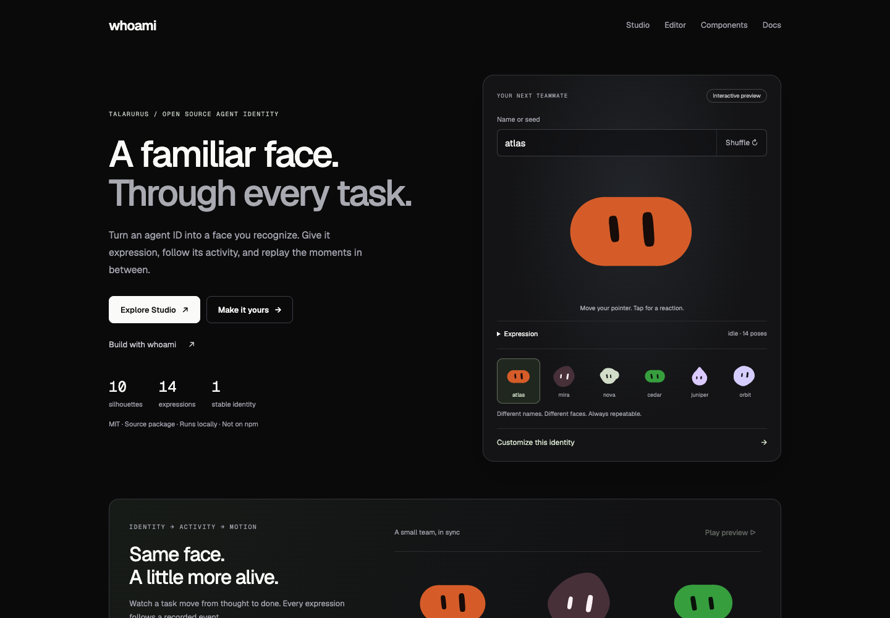

# whoami

A familiar face for every agent. Stable SVG identities, caller-driven task activity, React components, and an interactive Agent Identity Studio.

**v0.3.0** is the published source baseline. This checkout contains the **v0.3.1 visual pass for owner review**, with package metadata still at 0.3.0. Existing generation-2 artwork, seed mappings and public APIs are preserved. Nothing is published to npm or deployed as a hosted website.



A complete task in 5.5 seconds: **Idle → Thinking → Working → Completed**. The same three identities throughout, sampled from a validated version 1 demo recording.
[Static poster](assets/whoami-activity-poster.png) · [Original MP4](assets/whoami-activity-demo.mp4) · [Importable recording](assets/whoami-activity-demo.recording.json).



[Mobile homepage](assets/visual-parity-v0.3.1/after/home-390.png) ·
[Visual editor](assets/visual-parity-v0.3.1/after/editor-1440.png) ·
[Motion Studio](assets/visual-parity-v0.3.1/after/studio-motion-1440.png) ·
[Visual comparison and verification](docs/reviews/visual-parity-v0.3.1.md).

The [repository](https://github.com/talarurus/whoami) is public. The package remains `@talarurus/whoami`; installation uses a locally built tarball. Historical v0.1.0, v0.2.0 and v0.3.0 releases remain unchanged.

## Run the website

Use Node **24.21.0 or later in Node 24** and npm **11**. Cloning this public repository does not require a GitHub account.

```sh
git clone https://github.com/talarurus/whoami.git
cd whoami
npm ci
npm start
```

Open [Agent Identity Studio](http://localhost:4318/studio), [the website](http://localhost:4318), [editor](http://localhost:4318/editor), [components](http://localhost:4318/components), or [documentation](http://localhost:4318/docs). Stop with Ctrl-C. `PORT=4320 npm start` selects another port; restart to rebuild after edits.

## Use the source package

```sh
# In the whoami checkout
npm run build
npm pack
# In a separate application
npm install /absolute/path/to/talarurus-whoami-0.3.0.tgz
```

The package name below resolves through that local tarball. It is **not** an npm registry installation instruction.

```js
import { svgFor, identity } from '@talarurus/whoami';

const config = { name: 'agent-001', expression: 'happy' };
const svg = svgFor(config, 128);
console.log(identity(config).canonicalSeed);
```

The SVG entry has no runtime dependencies and includes TypeScript declarations. `node examples/svg.mjs` runs this path after building.

```tsx
import { Face } from '@talarurus/whoami/react';
import '@talarurus/whoami/motion.css';
import '@talarurus/whoami/gaze.css';
import '@talarurus/whoami/react.css';

export default function AgentAvatar() {
  return <Face name="agent-001" size={128} motion="always" pointerGaze
    decorative={false} label="Agent 001" />;
}
```

React **19.2** is a peer dependency for React consumers. Run `npm run example:react` after building, then open http://localhost:4319. See [API and integration](docs/api.md) and the [working TypeScript example](examples/react/main.tsx).

## Agent activity

```tsx
import { createActivityEngine } from '@talarurus/whoami/activity';
import { AgentAvatar } from '@talarurus/whoami/activity/react';

const engine = createActivityEngine({ agents: [{ id: 'atlas' }] });
const result = engine.dispatch({
  version: 1, agentId: 'atlas', taskId: 'task-001',
  sequence: 1, timestamp: 0, type: 'task.started',
});
if (!result.ok) console.error(result.code, result.error);

export function Agent() {
  return <AgentAvatar engine={engine} agentId="atlas" />;
}
```

Import the three CSS entries shown in the Face example for animated avatars. Optional `AgentScene` is exported from `@talarurus/whoami/scenes`; import `scenes.css` and `motion.css`. The engine has no React, renderer, clock or transport dependency. Caller-supplied events produce idle, waiting, thinking, working, needs-input, completed and error states. Sequences, task IDs and transition validation protect current state; accepted history is bounded. `replayActivity(options, recording)` deterministically reconstructs a complete caller recording.

The Studio uses these public exports for independent agents, task controls, input resolution, errors/reset, a navigable timeline, replay/pause/step/seek, validated local JSON import/export and copyable examples. Built-in events and controls are clearly simulated; imported recordings are labeled as caller-supplied. Its recording is in memory, capped at 120 accepted events; new sessions preserve agent identity. See [the schema and transition rules](docs/api.md), [typed examples](examples/activity/main.tsx), and [development verification](docs/development-v0.2.0.md).

Recording files use `@talarurus/whoami/recording`:

```ts
import { serializeRecording, parseRecording } from '@talarurus/whoami/recording';
const file = serializeRecording({ agents, events: completeAcceptedEvents });
if (file.ok) {
  const imported = parseRecording(file.json);
  if (imported.ok) console.log(imported.engine.getAgents());
}
```

The versioned envelope pins exact IDs, display names, event version and renderer revision. Import validates every event through a fresh engine; a failure leaves the caller’s session unchanged. SDK limits are 1 MiB / 1,000 events / 32 agents; Studio uses 256 KiB / 120 events / 8 agents. Recordings may contain caller-supplied task descriptions: review before sharing. Files stay local, with no upload or automatic persistence. See [the complete format](docs/api.md#json-activity-recordings--version-1), [typed example](examples/activity/recording.ts), and [final refinement and separate-agent review](docs/refinement-v0.2.0.md).

## Recorded motion and MP4

`@talarurus/whoami/motion` compiles complete version 1 recordings with an explicit
millisecond origin and motion policy into immutable per-agent tracks. Arbitrary
timestamps support repeatable seek/replay and position-continuous interruptions.
`/motion/react` provides `RecordedAgentAvatar` and `useMotionReducedPreference`;
the caller owns playback time. [Motion API and example](docs/motion-api.md).

Studio Motion mode previews multiple agents at one timestamp, with play/pause,
restart, speed and event/millisecond seeking. Reduced motion keeps manual seeking
and settled expressions. Live activity sessions are preserved during replay.

Optional `@talarurus/whoami/export/mp4` exports existing sampled artwork using
WebCodecs H.264 and a lazy MP4 muxer. Studio offers 512/1024 presets, progress,
cancel and explicit download. Frames use fixed timestamps independent of preview
speed/refresh rate. Limits: 30 fps, 1..8 agents, even 64..2048 dimensions, 30 seconds
including a one-second ending hold, 64 MiB, opaque background. No audio, captions
or animated companion scenes. Caller labels can appear in media; review before
sharing. [Export API and verified support](docs/mp4-export.md).

The same complete recording, pinned identity/motion revisions, origin, resolved
policy and frame configuration produce identical SVG samples and timestamps.
Browser fonts/rasterization, CSS idle/gaze animation and compressed video bytes
remain browser-dependent. Interruption continuity covers position, not velocity.

Chrome 155 and Playwright WebKit 26.5 passed genuine H.264 export/playback tests,
including multiple agents, cancellation and cleanup. Support is detected per
runtime/configuration; this does not certify every Safari/iOS device or browser.
The owner approved desktop/mobile Studio and the actual 512×512 MP4. Existing
media-decoding evidence is retained in [the verification record](docs/mp4-verification.json).

**Dependency maintenance risk:** optional video export bundles pinned MIT
`mp4-muxer@5.2.2`, deprecated upstream in favor of Mediabunny. Its original
copyright/license is retained. It remains unchanged for this release; future
maintenance, security or browser compatibility fixes may need a separately
reviewed replacement. Core/activity/recording/ordinary motion imports do not load
the muxer or video APIs. No universal codec availability is promised.

## Included and experimental surfaces

The typed activity engine, React subscriptions, event replay and versioned recording format are supported v0.2.0 APIs. Optional laptop scenes and the manual `/agent-scenes` playground remain experimental presentation surfaces; their artwork and playback are adapted from existing Blobatarling code. The password helper, chat, wall and other compositions are demonstrations, not authentication, messaging or agent-monitoring services.

- Ten silhouettes, fourteen expressions and 58 geometry/motion controls.
- Stable identities, eye tracking, click reactions, reduced-motion support and responsive layouts.
- Editor pins, shape/tone sets, palette overrides, revisioned share links and static SVG/PNG exports.
- Presence, agent list, user table, password helper and group chat examples; a browser-local wall.
- Six optional **experimental manual companion scenes** at `/agent-scenes`.

The standard artwork uses pinned Blobatar generation 2. This release preserves existing renderer bytes and identity behavior. The renderer, expressions, motion, gaze and laptop artwork are reused upstream work. The activity engine, replay, React activity binding and Studio are new first-party functionality. No automatic Codex/Claude monitoring, network transport, approval backend or scene export is included. Existing compositions remain checked-in examples; `Face` remains backward compatible.

The roster is fixed per engine, with one current task per agent. Callers supply increasing per-agent sequences, nondecreasing timestamps and unique task IDs across resets. Stale/out-of-order events are rejected rather than buffered. A bounded history tail may be incomplete for replay; retain the full accepted recording. SDK recording validation enforces unique task IDs across the whole recording. Reaching the maximum safe-integer sequence requires a new session. There are no durable sessions, external approval actions, automatic integrations or authentication guarantees.

PNG export is browser-only and static. Recorded MP4 uses the motion sampler; live gaze and CSS/companion animations are excluded. The website server and SVG endpoint bind to loopback; there is no hosted service or hot reload. Other frameworks and native SDKs are outside this release. Chrome/WebKit and emulated mobile viewport checks do not establish physical-device or all-browser compatibility.

## Checks and credits

```sh
npm run build
npm run typecheck
npm test
npm run check:release
npm run test:consumer
# With npm start running and Google Chrome installed:
npm run test:browser
```

[v0.3.0 release preparation](docs/releases/preparation-v0.3.0.md) records the final checks and publication gate; [release notes](docs/releases/v0.3.0.md) describe the scope. [v0.2.0 review](docs/refinement-v0.2.0.md) and [v0.1.0 validation](docs/validation.md) retain historical results and boundaries. [Provenance](docs/provenance.md) identifies adapted and independently authored work.

MIT: original renderer and adapted website code by **Alain / Alain00/blobatar**; compatible optional scene code from **SparshKaushik/blobatarling**, maintained by Sparsh Kaushik with additions authored by Khai. Original copyright notices are retained. Geist fonts are SIL OFL 1.1. See [LICENSE](LICENSE), [THIRD-PARTY-NOTICES](THIRD-PARTY-NOTICES.txt), and vendor license/source records. No upstream endorsement or legal clean-room claim is made.
